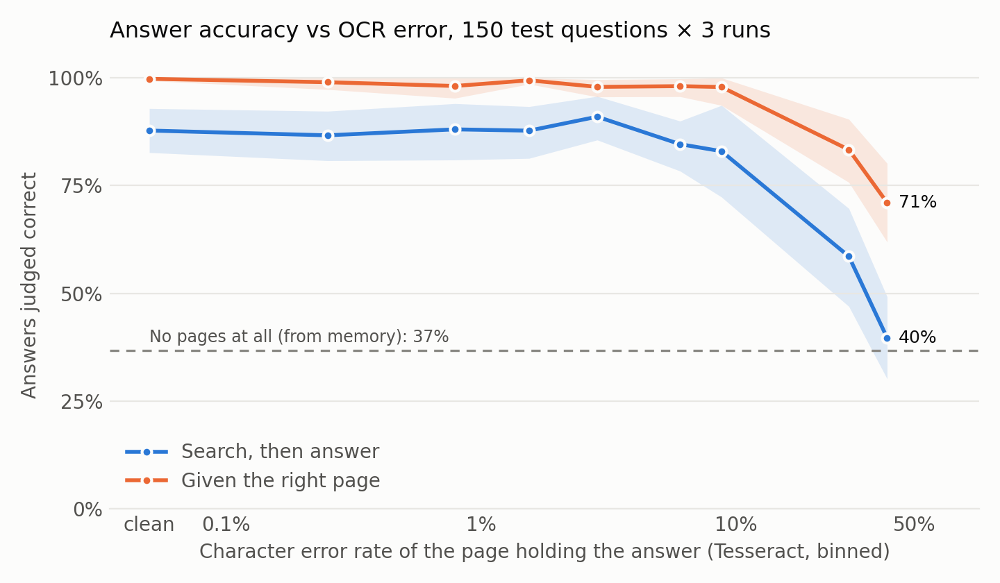

# PageProof

Ask questions about scanned books and get answers you can check against the page.

**Live demo:** [huggingface.co/spaces/giteshpoudel/pageproof](https://huggingface.co/spaces/giteshpoudel/pageproof): browse the saved test answers at every damage level, with the page highlighted.

PageProof measures how much OCR quality decides RAG answer quality. Most RAG demos start from clean text. Here the text comes from OCR of page images with known damage, every page keeps its exact source text, and each answer cites the page it came from.

> **Status:** Tesseract evals complete: **3 runs** over the 150 held-out test questions (6,750 judged answers). The Unlimited-OCR (vision-language model) source is still to come. Plan: [OCR_PROJECT_PLAN.md](OCR_PROJECT_PLAN.md).



## Results (Tesseract, 3 runs)

| OCR text the system reads | Median page CER | Search, then answer | Given the right page | Right page in top 5 |
|---|---|---|---|---|
| Clean text | 0% | 87.8% (82.7–92.9) | 99.8% | 89.3% |
| Tesseract, levels 0–4 | 0–7.2% | 83.8–89.3% | 97.8–98.9% | 87.3–92.0% |
| Tesseract, level 5 | 33.3% | **48.0%** (40.7–55.8) | **76.4%** | 69.3% |
| No pages (from memory) | — | 36.7% | — | — |

Each cell is 450 answers (150 questions × 3 runs); 95% bootstrap intervals over questions in brackets. The runs agree closely: per-run accuracy differs by at most 4 points in the cells checked (level 5 given the page: 74.0–78.0%), and 2,134 of 2,250 answers got the same verdict in all 3 runs. Source: [results/p4_test_cells.csv](results/p4_test_cells.csv), [results/p4_accuracy_vs_cer.csv](results/p4_accuracy_vs_cer.csv).

- **Up to about 7% character error rate, OCR errors don't move accuracy.** Levels 0–4 are within each other's confidence intervals and match clean text.
- **Past that, they hurt twice.** At 33% CER the model misreads the right page (99.8% → 76% when given it directly), and search finds the right page less often (89% → 69% in the top 5). Together: 88% → 48%.
- **Memory doesn't hide the drop.** 49 of the 150 test questions were answered correctly with no pages in at least 2 of 3 runs. At level 5 those score 48%, the rest 48%: knowing the book doesn't rescue a bad scan.
- **Noise is the damage that matters most.** At level 5, removing only the noise effect cuts Tesseract CER from 33% to 1.6%; removing blur, JPEG or low resolution leaves 9–20% ([results/p2_leave_one_out.csv](results/p2_leave_one_out.csv)).

## How it works

1. **Corpus with ground truth by construction.** 6 Project Gutenberg books (prose, verse, footnotes, tables of numbers), 65 contiguous pages each, rendered from HTML to page images. Each of the 390 pages is degraded at 6 calibrated levels (skew, blur, low resolution, noise, JPEG together), plus a leave-one-out set: 2,640 images, each with its exact source text.
2. **OCR.** Tesseract 5.5 on every image (median CER per level: 0%, 0.8%, 2.0%, 3.7%, 7.2%, 33.3%). Unlimited-OCR runs on a rented GPU are next.
3. **Index and answer.** Page-bounded chunks, hybrid search (BM25 + vectors, fused by reciprocal rank) in LanceDB, one index per OCR source × level. DeepSeek answers from the top 5 passages, cites page ids and quotes the passage; the quote is located on the page image and highlighted.
4. **Evals.** Three conditions per index: search-then-answer, oracle page (isolates reading) and closed book (the memory floor). A stronger model (deepseek-v4-pro) judges each answer against a reference.

## How the evals were checked

- **200 questions, 50 dev / 150 test.** Drafted by an LLM from the clean pages, each with an exact evidence quote and a gold page set found independently of the retriever. Mechanical checks rejected drafts whose quote wasn't on the page or whose question gave away the answer.
- **Question audit.** Two models looked for reasons to reject each question; 4 of 200 were flagged and 2 of those were rejected by hand. A random 20 of the questions that passed were checked by hand: 0 rejected, so at most 13.9% of the unchecked questions are bad (exact one-sided 95% bound).
- **Judge check.** On 60 sampled answers (half judged not correct), a second grader from a different model family agreed with the judge on all 60. The judge and a plain string match agree on 52 of 60; the 8 where they don't are waiting for a human label.

## What the evals caught

- **An OCR misread reaching the answer:** at level 5 "glass-grinding company" came back as "glue-grading company".
- **Questions answerable from memory:** the model answered 206 of 376 candidate questions with no pages, so every question carries a closed-book flag and results are reported both ways.
- **A truncation bug in that check:** the answering model reasons before it answers, and at a 3,000-token limit 38 of 376 closed-book answers came back empty and were scored wrong. The final runs allow 12,000 tokens.
- **Page numbers leaking into questions:** 40 drafted questions named a page number, which keyword search could match against "page N" in the chunk; they were rewritten.

## Limitations

- Synthetic damage on rendered pages, not real scans; Latin script only; no handwriting.
- One OCR source so far (Tesseract).
- The judge is checked against a second model, not yet against human labels.

## Try it

```bash
uv sync --extra demo
uv run python demo/export.py        # build demo/bundle from the corpus and saved runs
uv run --extra demo streamlit run demo/app.py
```

The demo browses the saved test answers at every damage level, with the page image highlighted. Asking your own question needs `DEEPSEEK_API_KEY` in `.env`. `demo/export.py --space build/space` also lays out a static Hugging Face Space: `demo/static/index.html` shows the same saved results in plain HTML and JavaScript, with no server, model or API calls. The corpus and indexes are rebuilt with the `pageproof` CLI (`corpus-build`, `ocr-tesseract`, `index-build`).

## License

MIT ([LICENSE](LICENSE)). The book texts are public domain, from Project Gutenberg.
